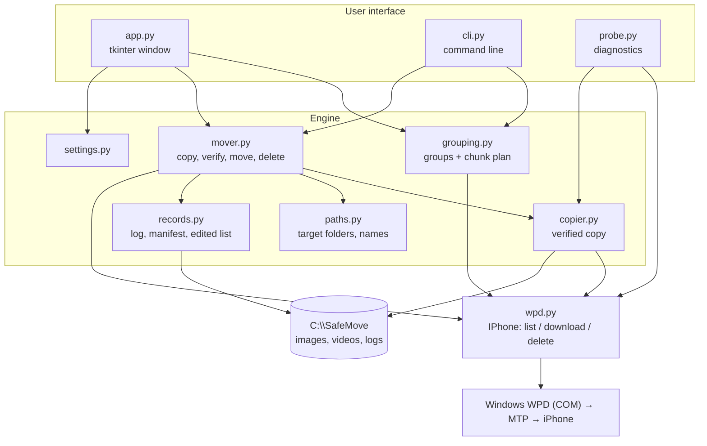
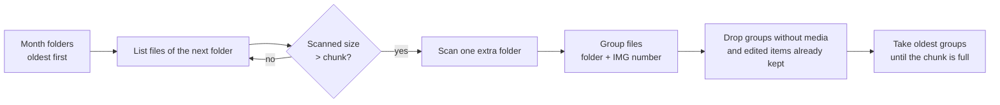
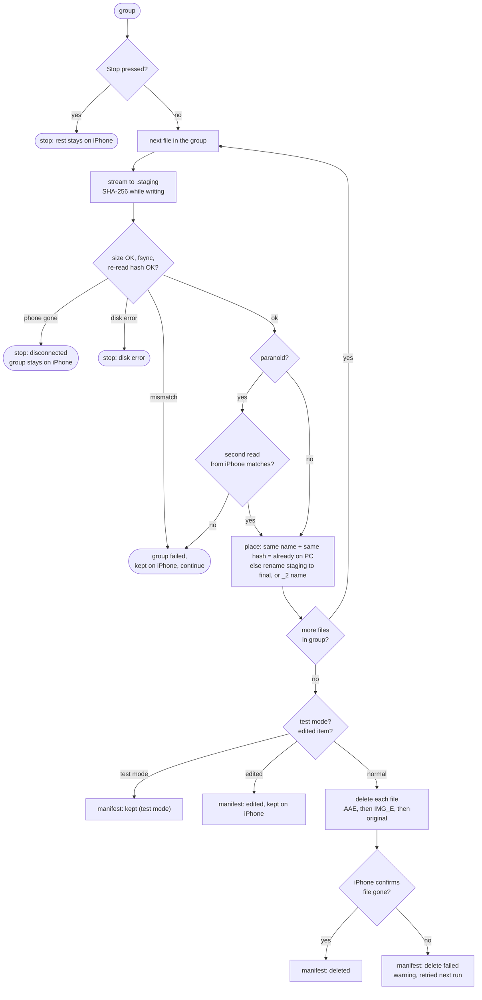

# SafeMove: architecture and design

This document explains how SafeMove works, why it is built this way, and what it can't do.
SafeMove was first called *iPhone Mover*; today it supports iPhones, and Android phones and cameras are planned (§11).
For day-to-day use, see the [User Guide](USER_GUIDE.md).

**Contents**
1. [Goal and constraints](#1-goal-and-constraints)
2. [Technology choices](#2-technology-choices)
3. [Components](#3-components)
4. [The move flow](#4-the-move-flow)
5. [Safety model](#5-safety-model)
6. [Data on disk](#6-data-on-disk)
7. [iPhone behavior found during testing](#7-iphone-behavior-found-during-testing)
8. [Packaging and installation](#8-packaging-and-installation)
9. [Limitations and known issues](#9-limitations-and-known-issues)
10. [Testing](#10-testing)
11. [Possible improvements](#11-possible-improvements)

---

## 1. Goal and constraints

**Problem.** Copying a large iPhone library to a Windows PC with copy and paste in Explorer often gets interrupted. Afterwards there's no way to know which files were copied completely, so it isn't safe to delete anything from the phone.

**Goal.** Move the library in chunks (oldest first, N GB at a time). Delete each file from the phone only after its copy on the PC is proven complete, and make any interruption harmless.

**Constraints.**

| Constraint | Consequence |
|---|---|
| Windows 11, iPhone over USB, no iCloud Photos: the iPhone holds the only copy | Deletion must be conservative and verifiable |
| **Smart App Control** is on | Any unsigned `.exe`/`.dll` we build is blocked, which rules out C#/.NET builds, PyInstaller and installer builders (see §2) |
| Must run on another laptop too | Portable, no admin rights, no internet needed |
| Library of ~25,000 files / ~175 GB (measured 2026-10-03) | Full scans are slow (~29 min), so the design avoids them |
| Only photos and videos | Other files on the phone are never touched |

---

## 2. Technology choices

| Choice | Why |
|---|---|
| **Python 3.11 + tkinter** | Python and tkinter are signed by the Python Software Foundation, so Smart App Control lets them run. Our code is plain `.py` text, which Smart App Control doesn't block. |
| **Windows Portable Devices (WPD)** via **comtypes** | WPD is the same interface Windows Explorer uses for the iPhone (MTP). Deleting through it lets iOS update its Photos library. comtypes is pure Python and calls the Windows COM API directly. |
| Not C#/.NET | Tried first (with the `MediaDevices` library). Every build was blocked by Smart App Control (`0x800711C7`, "an application control policy blocked this file"). |
| Not `pymobiledevice3` / AFC | Deleting files directly in the file system bypasses the Photos database and can leave grey "ghost" thumbnails. |
| Not PyInstaller / Inno Setup / MSI | They produce unsigned executables, which Smart App Control blocks. A real `.exe` would need a paid code-signing certificate. |

---

## 3. Components



| Module | Responsibility |
|---|---|
| `model.py` | Device-independent types: `DeviceFile`, file kinds (`media_kind`), the photo-folder pattern, `DeviceError`. No Windows API, so the engine and the tests run anywhere (CI). |
| `wpd.py` | `IPhone.connect()` finds the Apple device (USB vendor id `05AC`) and its photo folders. `list_files(folders)`, `download(file, out)` and `delete(file)`. **`delete()` is the only code that modifies the phone.** Raises `UnknownLayoutError` when the phone answers but uses folder names this version doesn't know. |
| `report.py` | Device report for new models / iOS versions: model, iOS version, storages, folder-name patterns (digits replaced by 9), file counts by extension and name pattern. No file names, serial number or device name. |
| `copier.py` | `verified_copy()`: streams the file to a local path, computing SHA-256 on the way, then checks the size, runs `fsync`, re-reads the file and re-hashes it. Classifies failures as `device` (phone gone), `disk` (local problem) or `verify` (mismatch). `hash_on_phone()` is used for paranoid mode. |
| `grouping.py` | `make_groups()` puts files that belong together into one group (key = folder + IMG number). `plan_chunk()` picks the oldest groups up to N GB, scanning only as many month folders as needed. |
| `paths.py` | `target_dir()` gives `images\|videos\YYYY\MM`. `place()` picks the final name: it reuses an existing identical file ("already on PC"), or adds `_2`, `_3`… on a name collision. |
| `mover.py` | `Mover.run(plan)` is the engine (§4). It emits `Event`s for the UI and returns a `Summary`. |
| `records.py` | Per-run text log, the append-only `manifest.csv`, and `edited-items-to-delete.txt`. |
| `settings.py` | Destination (and its drive's serial number), what to move, test mode, paranoid mode, free-space margins, in `%APPDATA%\SafeMove\settings.json`. Settings from the old name (`%APPDATA%\iPhoneMover`) are taken over once. |
| `drives.py` | The destination drive: `volume_of()` (letter, label, serial, file system, Windows drive or not), `relocate()` follows a drive to a new letter by its serial number, `min_free_bytes()` (20 GB on the Windows drive, 1 GB elsewhere), `too_big_for()` (FAT32 4 GB limit). |
| `app.py` | Window, plus a `Worker` thread that owns the iPhone connection. Single-instance guard. |
| `cli.py`, `probe.py` | Command-line runner; diagnostics used during development (read-only scan, manual copy/delete test). |
| `install.py` | Per-user install and uninstall (§8). |

### Threading

WPD objects are COM objects and must stay on the thread that created them. `app.py` runs **one background `Worker` thread** that calls `CoInitialize`, owns the `IPhone` object and processes jobs from a queue (`plan`, `run`). It posts messages back (`connected`, `scanning`, `plan`, `event`, `finished`, `disconnected`). The window polls that queue every 100 ms, so it never freezes during long copies. "Stop safely" sets a `threading.Event` that the engine checks between groups.

---

## 4. The move flow

### 4.1 Planning a chunk



- Photo folders are `YYYYMM_x` on recent iOS (e.g. `202408__`, `202409_a`) or `100APPLE` on older iOS, so sorting folder names sorts them by age.
- The **extra folder** is there because two folders can cover the same month and their dates can interleave.
- A group is never split. The first group is always taken, even if it's bigger than the chunk.
- Listing one month folder takes under a second. A full scan of 25,000 files took 29 minutes, so planning **never** does a full scan.

### 4.1b Planning a month or a day

`make_plan(phone, selection)` takes `('size', bytes)`, `('month', 'YYYY-MM')` or `('day', 'YYYY-MM-DD')`.

- **Month list** (`available_months`): built from folder names only (`202408_a` → `2024-08`), so it's instant.
- **Month / day** (`plan_period`): reads every folder of the month(s) concerned, **plus only the first folder of the following month**, where a photo taken late on the last day can be filed. Then it keeps the groups whose capture date is in the period. There's no size limit; the free-space check still applies.
- Why only the first folder: a busy month can have many folders (October 2024 has 10, `202410__` to `202410_i`). Reading them all made "September 2024" take 102 s instead of 0.4 s, with the same result.
- **Day list** (`day_summary`): files and bytes per day of a month, for the day picker.
- Undated folder names (`100APPLE`, older iOS) are always read, since their month is unknown.

### 4.2 Groups

| Example | Files | Goes to |
|---|---|---|
| Photo | `IMG_1009.HEIC` | `images\2024\08\` |
| Live Photo | `IMG_1001.HEIC` + `IMG_1001.MOV` | both to `images\…` (the clip stays next to its photo) |
| Video | `IMG_1006.MOV` | `videos\…` |
| Edited video | `IMG_1000.MOV` + `IMG_E1000.MOV` + `IMG_1000.AAE` | `videos\…`, **kept on the iPhone** |
| Other names | `ABCD1234.JPG` | its own group |

Rules: a group containing a photo goes entirely to `images`. The date (and so the `YYYY\MM` folder) comes from the photo/video, never from the `.AAE`, whose date is the edit date. An `.AAE` without a photo/video beside it is ignored.

### 4.3 Moving one group



The deletion check in `wpd.delete()`:
1. Refuses any file that isn't a photo, video or `.AAE`.
2. Re-reads the object's name and size and refuses if they differ (object ids can be reassigned after a reconnect).
3. Calls WPD `Delete` and treats `S_FALSE` ("some objects not deleted") as a failure.
4. Asks the iPhone for the object again: it must be gone. If that question fails, it checks that the iPhone still answers at all, so a disconnect can't be mistaken for a successful delete.

---

## 5. Safety model

| Rule | Where it's enforced |
|---|---|
| Nothing is deleted unless **every** file of its group is verified on disk | `Mover._move_group`: deletion runs only after the copy loop has completed for the whole group |
| Verification = size match + SHA-256 written == SHA-256 re-read from disk after `fsync` | `copier.verified_copy` |
| No half-written file ever appears in the archive | copy to `.staging\`, then an atomic `os.replace` on the same drive; `.staging\` is emptied at the start of each run |
| An existing file is never overwritten | `paths.place`: same content → reuse; different content → `_2`, `_3`… |
| Disconnect or disk error → stop at once | `error_kind` in `CopyResult` → outcome `disconnected` / `disk error` |
| A "deleted" answer is double-checked | `wpd.delete` (§4.3) |
| Only photos, videos and their `.AAE` can be deleted | `wpd.delete` refuses other files; `list_files` doesn't list them |
| Edited items are never deleted | `MediaGroup.is_edited` → status `edited, kept on iPhone` |
| The drive never fills up | Start is blocked unless `free − selection ≥ margin`: 20 GB on the Windows drive, 1 GB on other drives (`mover.free_space_problem`, `drives.min_free_bytes`, also checked by the UI) |
| No file the destination can't hold | On FAT/FAT32, a selection with a file of 4 GB or more is refused before anything is copied (`drives.too_big_for`, outcome `file system limit`) |
| Destination drive missing or unplugged | Nothing starts without the drive (`destination not found`); unplugging it mid-run stops with a clear message, and the group in progress stays on the phone |
| Test mode never deletes | `Options.test_mode` |
| Deletion needs explicit confirmation | Popup before every run with test mode off |
| One app instance at a time | Named mutex `Local\SafeMove.SingleInstance` |

**What verification can't prove.** The iPhone doesn't report a hash, so the PC can only prove that the copy matches *what the iPhone sent*. USB has its own error checking, and paranoid mode reads the file a second time to compare. Both together make silent corruption extremely unlikely, but it can't be proven against the original bytes stored on the phone.

---

## 6. Data on disk

```
C:\SafeMove\                         (destination, changeable)
  images\YYYY\MM\                  photos, Live Photo clips, edited-photo files
  videos\YYYY\MM\                  videos (and their edits)
  .staging\                        temporary; emptied at every start
  logs\
    2026-10-03_23-54-16.txt        one readable log per run
    manifest.csv                   every file ever handled (append-only)
    edited-items-to-delete.txt     edited items to delete by hand in Photos

%APPDATA%\SafeMove\settings.json
%LOCALAPPDATA%\Programs\SafeMove\   installed app (python\, lib\, safemove\)
```

**`manifest.csv` columns:** `moved_at, source_folder, source_name, dest_path, size_bytes, sha256, status`

| status | meaning |
|---|---|
| `deleted` | copied, verified, deleted from the iPhone |
| `already on PC, deleted` | an identical copy existed from an earlier run; deleted from the iPhone |
| `kept (test mode)` | copied and verified, test mode: not deleted |
| `edited, kept on iPhone` | edited item: copied and verified, not deleted on purpose (skipped by later plans) |
| `delete failed` | verified on the PC, but the iPhone didn't delete it; retried next run |

---

## 7. iPhone behavior found during testing

These findings shaped the design. They come from real runs (details and dates in the [development log](DEVELOPMENT_LOG.md)).

| Finding | Effect on the design |
|---|---|
| The iPhone exposes **3 storages**; only the third (`Internal Storage`) works, the other two reject every request (`0x80042008`) | Storages that fail are skipped |
| Recent iOS has **no `DCIM` folder**: month folders (`202408__`, `202409_a`…) sit directly under `Internal Storage` | Both layouts are supported |
| File and folder names are in `WPD_OBJECT_ORIGINAL_FILE_NAME`; `WPD_OBJECT_NAME` is empty | `_name()` reads the original name first |
| The **first listing after connecting is slow** (5–30 files/s) while the iPhone prepares file details; afterwards ~20,000 files in 37 s | Plan from the oldest folders only, never a full scan |
| The iPhone **drops off USB** during long operations, and connecting can hang until it's replugged and unlocked | Every call is wrapped; the run stops cleanly and resumes; the user guide says to set Auto-Lock to Never |
| A delete was once **reported as successful but didn't happen** (the iPhone stalled ~19 s, then disconnected) | `delete()` re-checks that the file is really gone |
| **Edited items come back**: deleting `IMG_1000` (original + `IMG_E` render, then also the `.AAE`) worked in the session, but after a replug the item was listed again, three times, including once with the Photos app force-closed. The iPhone also hung while deleting the edited render | Edited items are copied but never deleted; listed for manual deletion |
| The **USB file list isn't authoritative until a reconnect**: deletions and restorations sometimes only show after replugging | Verification after a reconnect is the real proof; see §9 |
| Normal photos, Live Photos and videos **stay deleted** (all ~350 checked after several replugs) | Automatic deletion is kept for them |
| With "Keep Originals", files arrive as originals (HEIC `ftypheic`, QuickTime `ftypqt` headers) | The guide requires the "Keep Originals" setting |

---

## 8. Packaging and installation

`build_portable.py` creates `dist\SafeMove-portable.zip` (~14 MB):

```
SafeMove\
  Install.cmd                 → python\pythonw.exe -m safemove.install
  SafeMove.cmd            run without installing
  SafeMove (console).cmd  same, with a console that shows errors
  README.txt
  python\                     official Python 3.11.9 embeddable (PSF-signed)
                              + tkinter: _tkinter.pyd, tcl86t.dll, tk86t.dll, tcl\
  lib\comtypes\               pure Python
  safemove\               our code + app.ico
```

- The **only binaries** are the PSF- and Microsoft-signed files of the official Python (33 files, all `Valid`). Unused Tcl extras (dde, registry, tix, nmake helper) are left out because they were the only unsigned files.
- `python311._pth` puts `.`, `Lib`, `..\lib` and `..` on the import path, so `comtypes` and `safemove` are found without installing anything.
- `safemove/__init__.py` sets `TCL_LIBRARY`/`TK_LIBRARY` when it runs from this layout, because shortcuts can't set environment variables.
- The build runs a **self-test** with the portable Python (import everything, open a hidden Tk window).

**Install** (`install.py`), per user, no admin rights:
1. Copies `python\`, `lib\`, `safemove\` and the README to `%LOCALAPPDATA%\Programs\SafeMove` (an update replaces `safemove\` entirely).
2. Creates Desktop and Start menu shortcuts to `pythonw.exe -m safemove.app`, with `app.ico`.
3. Registers `HKCU\Software\Microsoft\Windows\CurrentVersion\Uninstall\SafeMove`, so the app appears in **Settings → Apps**.

**Uninstall** removes the shortcuts and the registry key, then deletes the program folder in a separate process after the app exits. Photos, logs and settings are kept.

**Icon:** `make_icon.py` draws `app.ico` with plain Python (no image library) as PNG-in-ICO at 256/64/48/32/16 px.

---

## 9. Limitations and known issues

**iPhone / USB**
- **Edited photos and videos can't be deleted automatically.** The iPhone restores them. They must be deleted by hand in the Photos app, using `edited-items-to-delete.txt`. There are ~~930 edited items in the tested library.
- **A deletion confirmed during the session can still be undone by the iPhone**, which only shows after a reconnect. The app double-checks every delete within the session but doesn't automatically re-check after the next reconnect. Mitigation: the manifest makes any "came back" file easy to spot, and the next run recognizes it ("already on PC") and deletes it again.
- **Not verified: whether deleted items go to "Recently Deleted"** on the iPhone. Assume deletion is permanent.
- **The first scan after plugging in can be slow** (minutes) while the iPhone prepares file details.
- **The iPhone can disconnect mid-run**, especially if it locks. The run stops safely, but you have to replug, unlock and press Start again; there's no automatic reconnection.
- **Only one iPhone** is used (the first Apple device found). Other phones and cameras are ignored.
- **Tested on one model only (iPhone 11 Pro Max).** Other models and iOS versions may use other folder names; the app then stops with "unknown layout" and asks for a device report (`report.py`).

**Data**
- **After a move, the PC holds the only copy.** There's no built-in backup to a second drive yet.
- **Dates come from the iPhone's file information**, not from EXIF/QuickTime metadata inside the file. In tests they matched the capture dates, but a photo saved from another app may be filed under the date it was saved.
- **"Already on PC" detection** looks only in the destination's `YYYY\MM` folder for the same name and same hash. If the destination is changed between runs, or files are moved around by hand, those files are copied again (never lost, just duplicated).
- **Paranoid mode doubles transfer time.** Without it, verification proves the copy matches what the iPhone sent, not the stored original (§5).
- **Name collisions** are solved with `_2`, `_3`… suffixes. That's safe, but the names then differ from the iPhone's.

**App**
- **Windows only** (WPD); iPhones only (Apple vendor id).
- **"Stop safely" waits for the current group** to finish. A stuck iPhone call can't be interrupted, only ended by closing the app (safe: deletion never starts before a group is verified).
- **No automatic retry** of failed groups within a run; they're retried on the next run.
- **No real `.exe` or signed installer.** Install is a `.cmd` that runs the signed Python. A downloaded zip may need "Unblock" (Mark of the Web).
- **Throughput is limited by the iPhone/MTP:** ~17–23 MB/s measured, so ~10 minutes per 10 GB.
- **Settings and history are per laptop.** Using two laptops gives two separate archives and manifests. (With an external drive as destination, the archive and its logs travel with the drive.)
- **External drives are recognized by their volume serial number.** Reformatting a drive gives it a new serial, so choose the destination again afterwards.
- **Network drives (NAS) are not tested.** Atomic rename and `fsync` may behave differently there.

---

## 10. Testing

- **Automated (36 tests, `python -m pytest tests`).** `tests/fake_phone.py` mimics `IPhone` (folders, listing, chunked download, delete) and can inject failures: a disconnect halfway through a file, silent truncation, refused deletes. The tests cover grouping, chunk planning (including "only the needed folders are scanned"), the happy path, test mode, disconnect mid-group, rerun after an interruption ("already on PC"), name collisions, truncation, delete failures, low disk space, Stop safely, staging cleanup, folder/date fallback, Live Photo placement, edited items (copied, kept, listed, skipped next time), the `.AAE` dated later than its video, and month/day selection (late-filed photos, year boundary, only the first folder of the next month read, other months untouched), and destination drives (following a drive to a new letter, margins, FAT32 limit, missing drive, settings taken over from the old name).
- **Real device (see [DEVELOPMENT_LOG.md](DEVELOPMENT_LOG.md)):** full read-only scan; first manual copy → verify → delete; test-mode runs (0.5 GB, 0.7 GB); real moves with deletion (162 + 185 files); a real disconnect during a run; three edited-item deletion experiments; the portable zip and the installer on a laptop with Smart App Control on.
- **Checks used after real runs:** every manifest row ending in `deleted` must have a file at `dest_path` with the same size and SHA-256 (351/351 at last check), and none of them may be listed on the iPhone after a reconnect.

---

## 11. Possible improvements

Planned (agreed next steps):

- **Android phones.** They also use MTP through WPD. Needed: a device-profile layer (how to find the device, which folders: `DCIM\Camera`, `Pictures\Screenshots`, SD card…, dates from file names like `IMG_20240818_105528.jpg` / `PXL_…`, grouping rules, what may be deleted), and testing deletion per brand. Month/day planning needs a full listing, since there are no month folders.
- **Cameras** (PTP/MTP, `DCIM\100XXXXX`) as another device profile.
- **Second copy:** copy to the PC **and** an external drive, verify both, and only then delete from the phone.

Other ideas:

- **Post-reconnect audit:** at startup, compare the manifest's `deleted` rows with the iPhone's listing and report any file that "came back".
- **Automatic reconnect** after a disconnect (wait for the device, then continue).
- **EXIF/QuickTime dates** for files whose phone date looks wrong.
- **Longer date ranges** ("everything before 2025"); month and day selection already exist.
- **Duplicate detection** across the archive by hash.
- **A signed `.exe`/installer**, if a code-signing certificate is ever bought.
